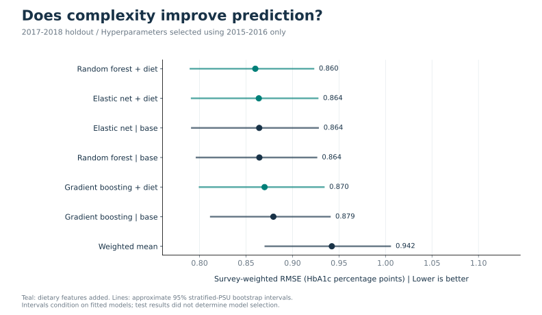
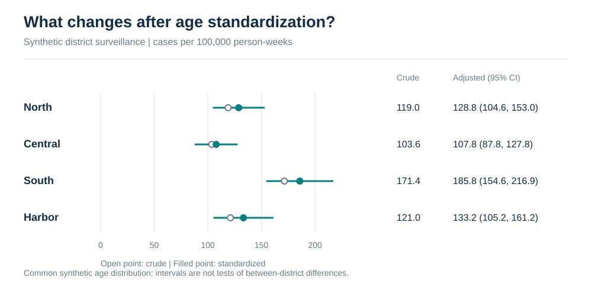
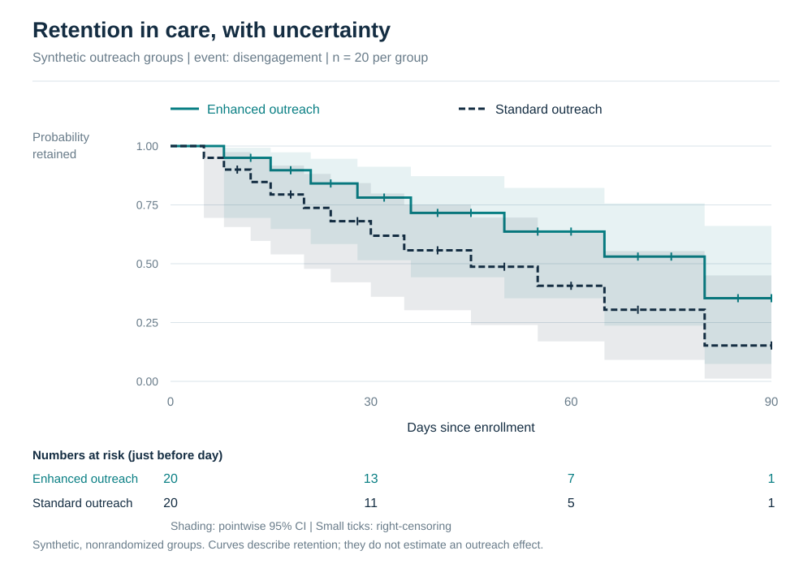
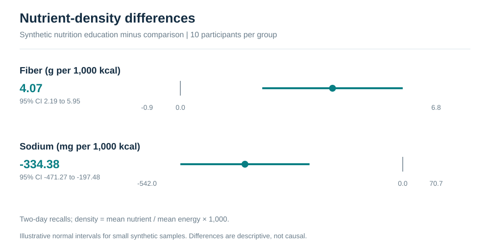

# Public Health Methods Lab

[](https://github.com/mjeans/public-health-methods-lab/actions/workflows/validate.yml)
[](https://doi.org/10.5281/zenodo.24267622)

A reproducible portfolio of nutrition, epidemiology, biostatistics, and machine-learning methods. The core lab uses deterministic synthetic examples; the self-contained nutrition ML project uses documented CDC/NCHS NHANES public-use data.

> No row-level records or protected health information are republished. Core examples are synthetic; the nutrition ML extension downloads official public-use inputs locally and publishes aggregate results only.

## Featured: nutrition and machine learning

**New research companions:** [When Methods Fail: 46,000 simulated datasets](projects/methods-stress-test) · [Nutrition ML research brief (PDF)](projects/nutrition-machine-learning/output/pdf/nutrition-ml-research-brief.pdf) · [Published research to inspectable methods](docs/tx-sprouts-research-companion.md).

**Do dietary summaries improve prediction of measured HbA1c in a separate NHANES survey cycle?**

[Open the complete project](projects/nutrition-machine-learning) · [Executed results](projects/nutrition-machine-learning/outputs/report.md) · [Methods](projects/nutrition-machine-learning/docs/methods.md) · [Model card](projects/nutrition-machine-learning/docs/model-card.md)

The benchmark compares elastic net, random forest, and gradient boosting against a weighted-mean baseline, using training-only preprocessing, PSU-grouped cross-validation, later-cycle evaluation, paired uncertainty intervals, and subgroup diagnostics. It combines nutritional sciences with rigorous predictive evaluation—not clinical deployment or causal dietary claims.

**Main finding:** adding the selected dietary summaries did not clearly improve the development-selected pipeline on the later cycle. Inspect the uncertainty and limitations alongside the scores.



The extension has its own pinned dependencies, tests, fixed analysis plan, reproduction checks, and [validation workflow](https://github.com/mjeans/public-health-methods-lab/actions/workflows/nutrition-ml.yml). The core lab below remains dependency-free.

## Core synthetic examples

1. How do district case rates compare after direct age standardization?
2. Does a weekly count cross a transparent rolling surveillance threshold?
3. What is the attack-rate ratio for a suspected outbreak exposure?
4. How does time retained in care differ between two outreach groups when observations are right-censored?
5. How do energy-adjusted fiber and sodium densities differ when two 24-hour recalls are averaged per participant?

## Results at a glance



The synthetic South district has the highest age-standardized rate. Standardization changes the comparison from one driven partly by different age structures to one based on a common reference population. Approximate Poisson confidence intervals keep sampling uncertainty visible.



The synthetic enhanced-outreach group remains in care longer in the descriptive Kaplan-Meier analysis. Because group assignment is not randomized and the sample is constructed for demonstration, this is not a causal effect estimate.

The complete deterministic findings are in [the generated summary](outputs/summary.md).

### Nutrition epidemiology case study



The nutrition analysis averages two synthetic 24-hour recalls per participant, expresses fiber and sodium per 1,000 kilocalories, reports dietary-data completeness, and estimates descriptive group differences with uncertainty. It demonstrates dietary measurement and energy adjustment without presenting synthetic values as clinical findings or program effects.

See the [nutrition case study](docs/nutrition-case-study.md), [group summaries](outputs/nutrition_density_summary.csv), and [group contrasts](outputs/nutrition_group_contrasts.csv).

## Methods

| Domain | Implementation | Reviewable output |
|---|---|---|
| Public-health surveillance | Crude rates, direct age standardization, rolling z-score signal | `age_standardized_rates.csv`, `weekly_surveillance_signals.csv` |
| Nutritional epidemiology | Two-day recall averaging, nutrient density per 1,000 kcal, completeness, descriptive mean differences | `nutrition_density_summary.csv`, `nutrition_group_contrasts.csv` |
| Epidemiology | Attack rates, risk ratio, log-scale 95% CI | `outbreak_risk_ratio.csv` |
| Biostatistics | Kaplan-Meier estimation, right-censoring, Greenwood log-log CI, median event time | `retention_curve.csv` |
| Reproducibility | Dependency-free Python, deterministic fixtures, regression tests, GitHub Actions | workflow badge and tests |

The formulas, estimands, and interpretation limits are documented in [Methods and assumptions](docs/methods.md).

## Repository map

```text
./
  src/            Inspectable statistical functions
  scripts/        Deterministic analysis and figure generation
  tests/          Unit and regression tests
  outputs/        Reproducible tables and narrative summary
  assets/         Reproducibly generated SVG figures
  docs/           Methods, assumptions, and interpretation boundaries
  data/           Data-governance note; no row-level health data
  projects/
    nutrition-machine-learning/   Self-contained real-data ML benchmark
```

## Run the core lab

Python 3.11 or later is the only requirement for the core synthetic examples. The [nutrition ML project](projects/nutrition-machine-learning#reproduce) has separate Python 3.12 dependencies and commands.

```bash
python tests/test_methods.py
python scripts/run_analysis.py
```

The core GitHub Actions workflow runs its tests, rebuilds the core outputs, and fails if committed results drift. The separate nutrition ML workflow checks its unit tests and numerical reproduction.

## Responsible interpretation

The core lab demonstrates statistical implementation under known synthetic conditions. The nutrition ML extension is a separate public-use-data portfolio benchmark; read its [model card](projects/nutrition-machine-learning/docs/model-card.md) for use restrictions and survey/measurement limitations. A real analysis would require a protocol, data provenance review, dietary-instrument and case-definition governance, missingness assessment, small-cell rules, privacy review, appropriate measurement and surveillance methods, design-aware inference, and subject-matter interpretation. Statistical associations and alert thresholds do not identify causes on their own.

## Citation

Jeans, M. (2026). *Public Health Methods Lab* (v1.1.0) [Computer software]. Zenodo. [https://doi.org/10.5281/zenodo.24267623](https://doi.org/10.5281/zenodo.24267623)

Use this version-specific DOI to cite the [validated v1.1.0 release](https://github.com/mjeans/public-health-methods-lab/releases/tag/v1.1.0). The badge links to the [all-versions DOI](https://doi.org/10.5281/zenodo.24267622); `main` is the evolving development branch. [`CITATION.cff`](CITATION.cff) describes the latest archived release. Acknowledge the original public data sources where used.

[Archive verification and future-release checklist](docs/archiving.md).

## License

Code and documentation are available under the [MIT License](LICENSE).
