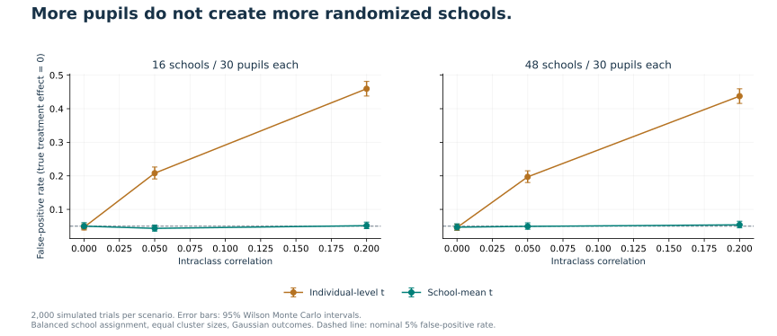

# When Methods Fail

**How much confidence should we place in a clean-looking estimate when its assumptions are wrong?**

A reproducible simulation study connecting nutritional measurement, missing-data methods, and school-based research design. **23 scenarios, 2,000 repetitions each, 46,000 synthetic datasets.** Competing methods see the same simulated samples; results include Monte Carlo uncertainty and paired comparisons.

[Executed findings](outputs/report.md) · [Design and formulas](docs/methods.md) · [Fixed configuration](config/design.json) · [Aggregate results](outputs/summary.csv)

## Three findings to inspect

- **Measurement error:** averaging two recalls reduces attenuation but does not eliminate it. Calibration with known error variance works under its independent-error assumption; correlated recall errors break that assumption.
- **Missing outcomes:** weighting and regression standardization recover the target in the specified MAR setting, but fail when response also depends on an unobserved outcome error.
- **Clustering:** with 16 schools, 30 pupils per school, ICC 0.20, and no treatment effect, individual-level testing rejected about **46%** of the time; school-mean testing rejected about **5%**.

These are results of the stated synthetic mechanisms, not estimates of error rates in real nutrition studies.



## What makes the comparison reviewable

- Separate experiments isolate one failure mechanism at a time.
- Null and non-null effects distinguish false positives from power.
- Oracles and known-parameter benchmarks are explicitly labeled; they are not presented as deployable corrections.
- Coverage targets the generating parameter, not a convenient biased limit.
- Wilson Monte Carlo intervals retain uncertainty even with zero observed events.
- Fixed scenario-specific random streams support exact reruns and fair paired comparisons.
- Tests check reference estimators, data-leakage boundaries, and the standardization influence function by numerical differentiation.

## Reproduce

From the repository root, use Python 3.12 in a fresh environment:

```bash
python -m pip install -r projects/methods-stress-test/requirements.txt
python -m unittest discover -s projects/methods-stress-test/tests -v
python projects/methods-stress-test/scripts/run_simulation.py --check
```

The full check reruns all 46,000 datasets and compares both accepted aggregate tables within 2e-6 tolerance. For a quick development check, use `--smoke`; its outputs go to ignored `artifacts/smoke`, never the published results. Running without either flag regenerates aggregates and graphics and should accompany review of a justified design/code change.

This is a fixed computational plan, **not an externally preregistered study**. Synthetic observations remain in memory; only aggregate performance evidence is published. Results describe these generating mechanisms, not every form of dietary error, nonresponse, or cluster-randomized trial.

[Related nutrition ML benchmark](../nutrition-machine-learning) · [Publication-to-methods companion](../../docs/tx-sprouts-research-companion.md). Code and documentation: [MIT](../../LICENSE).
