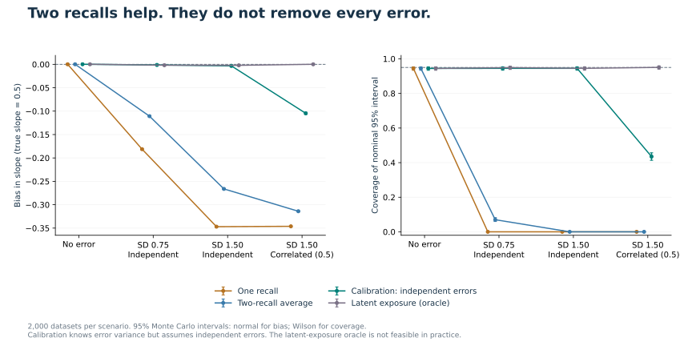
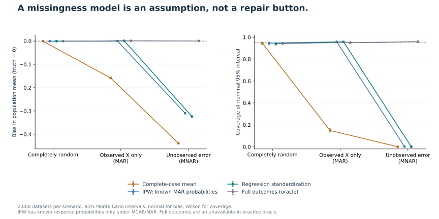
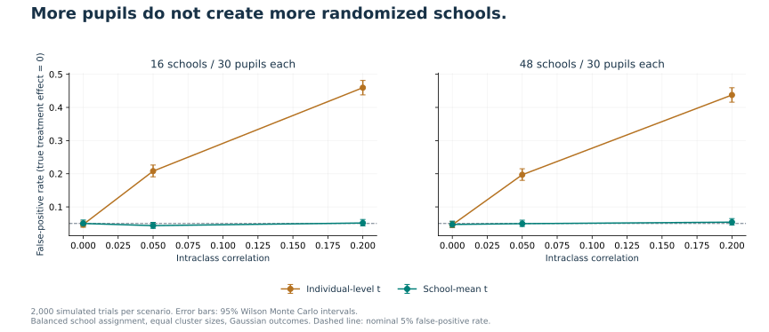

# When methods fail: executed simulation

**2,000 repetitions per scenario; 23 scenarios.** Fixed seed streams. All observations are synthetic.

Three controlled experiments isolate measurement error, selective missingness, and clustering. They are not a factorial reconstruction of any published study.

## Measurement error

Calibration uses a known error variance and assumes independent recall errors. It is a favorable benchmark, not a validated real-data correction. Latent exposure is an unavailable-in-practice oracle.

## Missing outcomes

IPW receives known MAR probabilities under MCAR/MAR but the same incorrectly assumed MAR model under MNAR. Regression standardization models observed outcomes using X. Neither method is given the unobserved outcome errors. The full-data comparator is an oracle.

## Clustered assignment

School-mean t intervals match the independent assignment units under this balanced, equal-size, Gaussian design. This does not establish validity for unequal, informative, or few-cluster designs in general.

## Full results

| Scenario | Method | Truth | Bias (MCSE) | 95% coverage (MCSE) | Reject zero | Failures |
|---|---|---:|---:|---:|---:|---:|
| 100 | One recall | 0.00 | +0.001 (0.001) | 0.955 (0.005) | 0.045 | 0 |
| 100 | Two-recall average | 0.00 | +0.001 (0.001) | 0.955 (0.005) | 0.045 | 0 |
| 100 | Calibration: independent errors | 0.00 | +0.001 (0.001) | 0.955 (0.005) | 0.045 | 0 |
| 100 | Latent exposure (oracle) | 0.00 | +0.001 (0.001) | 0.955 (0.005) | 0.045 | 0 |
| 101 | One recall | 0.00 | -0.000 (0.001) | 0.944 (0.005) | 0.056 | 0 |
| 101 | Two-recall average | 0.00 | -0.000 (0.001) | 0.947 (0.005) | 0.053 | 0 |
| 101 | Calibration: independent errors | 0.00 | -0.001 (0.001) | 0.947 (0.005) | 0.053 | 0 |
| 101 | Latent exposure (oracle) | 0.00 | -0.000 (0.001) | 0.941 (0.005) | 0.059 | 0 |
| 102 | One recall | 0.00 | -0.001 (0.000) | 0.950 (0.005) | 0.050 | 0 |
| 102 | Two-recall average | 0.00 | -0.001 (0.001) | 0.950 (0.005) | 0.050 | 0 |
| 102 | Calibration: independent errors | 0.00 | -0.002 (0.001) | 0.950 (0.005) | 0.050 | 0 |
| 102 | Latent exposure (oracle) | 0.00 | -0.002 (0.001) | 0.948 (0.005) | 0.052 | 0 |
| 103 | One recall | 0.00 | +0.000 (0.000) | 0.944 (0.005) | 0.056 | 0 |
| 103 | Two-recall average | 0.00 | -0.000 (0.000) | 0.954 (0.005) | 0.046 | 0 |
| 103 | Calibration: independent errors | 0.00 | -0.000 (0.001) | 0.954 (0.005) | 0.046 | 0 |
| 103 | Latent exposure (oracle) | 0.00 | -0.001 (0.001) | 0.944 (0.005) | 0.056 | 0 |
| 104 | One recall | 0.50 | +0.000 (0.001) | 0.945 (0.005) | 1.000 | 0 |
| 104 | Two-recall average | 0.50 | +0.000 (0.001) | 0.945 (0.005) | 1.000 | 0 |
| 104 | Calibration: independent errors | 0.50 | +0.000 (0.001) | 0.945 (0.005) | 1.000 | 0 |
| 104 | Latent exposure (oracle) | 0.50 | +0.000 (0.001) | 0.945 (0.005) | 1.000 | 0 |
| 105 | One recall | 0.50 | -0.181 (0.001) | 0.000 (0.000) | 1.000 | 0 |
| 105 | Two-recall average | 0.50 | -0.111 (0.001) | 0.070 (0.006) | 1.000 | 0 |
| 105 | Calibration: independent errors | 0.50 | -0.001 (0.001) | 0.945 (0.005) | 1.000 | 0 |
| 105 | Latent exposure (oracle) | 0.50 | -0.002 (0.001) | 0.949 (0.005) | 1.000 | 0 |
| 106 | One recall | 0.50 | -0.347 (0.000) | 0.000 (0.000) | 1.000 | 0 |
| 106 | Two-recall average | 0.50 | -0.266 (0.001) | 0.000 (0.000) | 1.000 | 0 |
| 106 | Calibration: independent errors | 0.50 | -0.003 (0.001) | 0.945 (0.005) | 1.000 | 0 |
| 106 | Latent exposure (oracle) | 0.50 | -0.002 (0.001) | 0.945 (0.005) | 1.000 | 0 |
| 107 | One recall | 0.50 | -0.346 (0.000) | 0.000 (0.000) | 1.000 | 0 |
| 107 | Two-recall average | 0.50 | -0.314 (0.001) | 0.000 (0.000) | 1.000 | 0 |
| 107 | Calibration: independent errors | 0.50 | -0.105 (0.001) | 0.435 (0.011) | 1.000 | 0 |
| 107 | Latent exposure (oracle) | 0.50 | +0.000 (0.001) | 0.951 (0.005) | 1.000 | 0 |
| 200 | Complete-case mean | 0.00 | -0.000 (0.001) | 0.947 (0.005) | 0.053 | 0 |
| 200 | IPW: known MAR probabilities | 0.00 | -0.000 (0.001) | 0.946 (0.005) | 0.054 | 0 |
| 200 | Regression standardization | 0.00 | -0.000 (0.001) | 0.940 (0.005) | 0.060 | 0 |
| 200 | Full outcomes (oracle) | 0.00 | -0.000 (0.001) | 0.946 (0.005) | 0.054 | 0 |
| 201 | Complete-case mean | 0.00 | -0.158 (0.001) | 0.148 (0.008) | 0.852 | 0 |
| 201 | IPW: known MAR probabilities | 0.00 | +0.000 (0.001) | 0.958 (0.004) | 0.042 | 0 |
| 201 | Regression standardization | 0.00 | +0.001 (0.001) | 0.958 (0.004) | 0.042 | 0 |
| 201 | Full outcomes (oracle) | 0.00 | +0.001 (0.001) | 0.951 (0.005) | 0.050 | 0 |
| 202 | Complete-case mean | 0.00 | -0.439 (0.001) | 0.000 (0.000) | 1.000 | 0 |
| 202 | IPW: known MAR probabilities | 0.00 | -0.310 (0.001) | 0.002 (0.001) | 0.999 | 0 |
| 202 | Regression standardization | 0.00 | -0.324 (0.001) | 0.000 (0.000) | 1.000 | 0 |
| 202 | Full outcomes (oracle) | 0.00 | +0.001 (0.001) | 0.960 (0.004) | 0.040 | 0 |
| 300 | Individual-level t | 0.00 | -0.000 (0.002) | 0.953 (0.005) | 0.047 | 0 |
| 300 | School-mean t | 0.00 | -0.000 (0.002) | 0.950 (0.005) | 0.050 | 0 |
| 301 | Individual-level t | 0.30 | +0.000 (0.002) | 0.952 (0.005) | 0.910 | 0 |
| 301 | School-mean t | 0.30 | +0.000 (0.002) | 0.952 (0.005) | 0.858 | 0 |
| 302 | Individual-level t | 0.00 | -0.001 (0.003) | 0.792 (0.009) | 0.208 | 0 |
| 302 | School-mean t | 0.00 | -0.001 (0.003) | 0.957 (0.005) | 0.043 | 0 |
| 303 | Individual-level t | 0.30 | -0.001 (0.003) | 0.782 (0.009) | 0.792 | 0 |
| 303 | School-mean t | 0.30 | -0.001 (0.003) | 0.949 (0.005) | 0.498 | 0 |
| 304 | Individual-level t | 0.00 | +0.008 (0.005) | 0.540 (0.011) | 0.460 | 0 |
| 304 | School-mean t | 0.00 | +0.008 (0.005) | 0.949 (0.005) | 0.051 | 0 |
| 305 | Individual-level t | 0.30 | -0.003 (0.005) | 0.560 (0.011) | 0.728 | 0 |
| 305 | School-mean t | 0.30 | -0.003 (0.005) | 0.955 (0.005) | 0.205 | 0 |
| 306 | Individual-level t | 0.00 | +0.001 (0.001) | 0.954 (0.005) | 0.046 | 0 |
| 306 | School-mean t | 0.00 | +0.001 (0.001) | 0.953 (0.005) | 0.047 | 0 |
| 307 | Individual-level t | 0.30 | +0.000 (0.001) | 0.955 (0.005) | 1.000 | 0 |
| 307 | School-mean t | 0.30 | +0.000 (0.001) | 0.957 (0.005) | 1.000 | 0 |
| 308 | Individual-level t | 0.00 | +0.000 (0.002) | 0.803 (0.009) | 0.197 | 0 |
| 308 | School-mean t | 0.00 | +0.000 (0.002) | 0.951 (0.005) | 0.050 | 0 |
| 309 | Individual-level t | 0.30 | +0.002 (0.002) | 0.798 (0.009) | 0.992 | 0 |
| 309 | School-mean t | 0.30 | +0.002 (0.002) | 0.957 (0.005) | 0.950 | 0 |
| 310 | Individual-level t | 0.00 | -0.001 (0.003) | 0.562 (0.011) | 0.438 | 0 |
| 310 | School-mean t | 0.00 | -0.001 (0.003) | 0.946 (0.005) | 0.054 | 0 |
| 311 | Individual-level t | 0.30 | -0.001 (0.003) | 0.555 (0.011) | 0.929 | 0 |
| 311 | School-mean t | 0.30 | -0.001 (0.003) | 0.953 (0.005) | 0.568 | 0 |

Reject-zero is a false-positive rate only where truth = 0; otherwise it is power. Coverage targets the generating parameter, not the attenuated observed-exposure slope.

Coverage and rejection MCSE use sqrt[p(1-p)/R]. Bias MCSE uses empirical SD / sqrt(R). Worst-case binomial MCSE at R=2,000 is 0.0112; near 95% coverage it is 0.0049. These are simulation errors, not participant-level confidence intervals.

Wilson Monte Carlo intervals for coverage and rejection are included in the CSV and figures. A zero plug-in MCSE after zero events is not evidence of zero uncertainty.

Same simulated data feed competing methods. [Paired comparisons](paired-comparisons.csv) report within-repetition differences and their MCSE. No failed fit is silently removed: an unexpected estimator exception stops the run; the summary also reports nonfinite-result failures.

Design SHA-256: 01b67d936a4c541de2616a11f0c465d79ad5bdccfad158dd0a781f4e3a67fd40. [Design](../config/design.json) · [Methods and formulas](../docs/methods.md) · [Machine-readable summary](summary.csv).

This fixed computational plan is not an externally preregistered protocol. Results apply to the supplied generating mechanisms, not all dietary research. No findings from TX Sprouts or NHANES are reestimated by this simulation.
