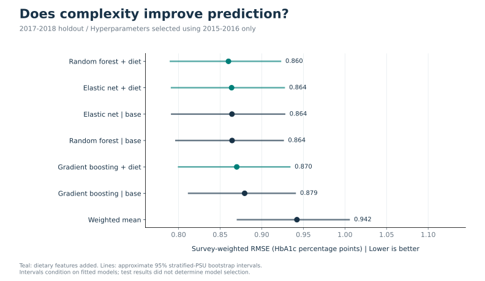
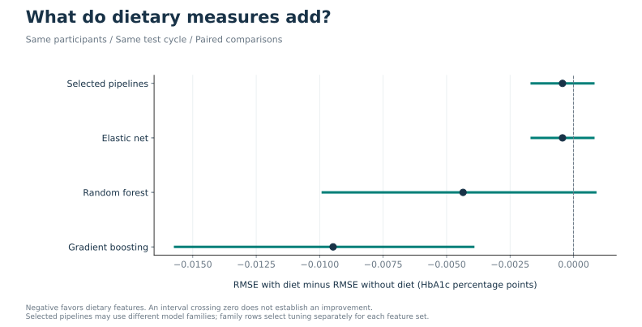

# Nutrition and Machine Learning

[](https://github.com/mjeans/public-health-methods-lab/actions/workflows/nutrition-ml.yml)

**Do dietary measures improve prediction of measured HbA1c—and does a more complex model help?**

A Python benchmark using real CDC/NCHS NHANES public-use data, combining nutritional epidemiology with careful machine-learning evaluation. Develop on 2015-2016; test on a separate 2017-2018 sample. Compare demographic/body-measurement predictors with the same predictors plus two-day dietary summaries.

[Read the executed results](outputs/report.md) · [Methods](docs/methods.md) · [Model card](docs/model-card.md) · [Fixed analysis plan](config/analysis-plan.json)

**Research brief:** [Three-page PDF](output/pdf/nutrition-ml-research-brief.pdf) · [Self-contained HTML](outputs/research-brief.html). Both are generated directly from the committed aggregate evidence by [the brief builder](../../scripts/build_nutrition_brief.py); neither refits the models.

## The result, not just the algorithm

- **3,999 development participants; 3,947 test participants.** Both feature sets use identical cohorts.
- **Elastic net was selected during development**, ahead of the candidate random forests and gradient-boosted models. The test set was not used to choose the model.
- The selected dietary pipeline achieved **0.8637 weighted RMSE**, versus **0.8642 without diet** and **0.9423 for the development-mean baseline**, in HbA1c percentage points.
- Adding diet changed RMSE by **-0.0004**, with an approximate paired 95% interval of **-0.0016 to +0.0008**. These dietary summaries did not clearly improve the selected model. This is not evidence that diet is unimportant to health.

Random forest with diet had the lowest observed test RMSE (0.8600), but it does not replace the development-selected model after seeing the test results. That distinction is part of the example.



## What reviewers can inspect

| Question | Evidence |
|---|---|
| Were the models compared fairly? | [Same-sample paired dietary comparison](outputs/dietary-comparisons.csv), with uncertainty from common PSU resamples |
| Could test information leak into training? | [Training-only preprocessing and grouped CV](src/nutrition_ml/modeling.py), plus leakage-focused tests |
| Were survey design and missingness addressed? | [Weights, cohort flow, missingness, and limitations](docs/methods.md) |
| Where does prediction fail? | [Subgroup errors, residual diagnostics, and sensitivity checks](outputs/report.md#error-patterns) |
| What does the model do with nutrition features? | [Accumulated local effect curves](assets/model-effects.svg), explicitly noncausal |
| Can someone reproduce it? | [Source hashes](data/source-manifest.json), pinned dependencies, a one-command run, and checked reference aggregates |



## Reproduce

This is a self-contained project within the Public Health Methods Lab. From a clone of the lab, enter `projects/nutrition-machine-learning`. Use Python 3.12 in a fresh virtual environment:

```bash
cd projects/nutrition-machine-learning
python -m pip install -r requirements.txt
python -m unittest discover -s tests -v
python scripts/run_pipeline.py
python scripts/verify_outputs.py
```

The pipeline downloads 12 public CDC files, verifies their hashes, performs grouped development cross-validation, freezes model choices, and evaluates the later cycle. It regenerates aggregate tables, four SVG figures, and the report. Small platform-level floating-point differences are allowed by a 2e-6 numeric reproduction tolerance. Local PNG previews, raw files, and fitted models are ignored by Git.

The committed reference is intentionally updated only after reviewing a justified change with `python scripts/verify_outputs.py --accept-reference`. CI never accepts a new reference automatically. Repeated reproduction is not new independent validation; do not tune to the existing test cycle after viewing the results.

```text
config/                 Fixed design, features, and tuning grid
src/nutrition_ml/       Cohort, model selection, evaluation, reporting
scripts/                End-to-end execution and reference checks
tests/                  Synthetic unit fixtures and accepted aggregate reference
outputs/                Executed aggregate evidence, never individual records
assets/                 Source-generated scientific figures
data/                   Provenance and public-source checksums
docs/                   Methods and responsible-use model card
```

## Interpretation boundaries

This is a research portfolio demonstration, not a clinical product. It predicts a biomarker measured in the same survey cycle, not future disease. Recall error, treatment-related dietary change, missing outcome data, and survey design limit interpretation. Neither a feature's model effect nor predictive importance establishes causation. Subgroup audits do not establish fairness or clinical safety.

Built by [Matthew Jeans, PhD, PMP](https://github.com/mjeans), with a PhD in Nutritional Sciences. [ORCID](https://orcid.org/0000-0002-1140-3185).

Related work: [NHANES survey analysis](https://github.com/mjeans/nhanes-nutrition-survey-analysis) · [Education predictive modeling](https://github.com/mjeans/student-success-predictive-modeling).

## License and data attribution

Code and documentation: [MIT](LICENSE). Data: CDC/NCHS NHANES, governed by the original public-use source terms. No row-level records are republished. See the [data provenance notes](data/README.md).
