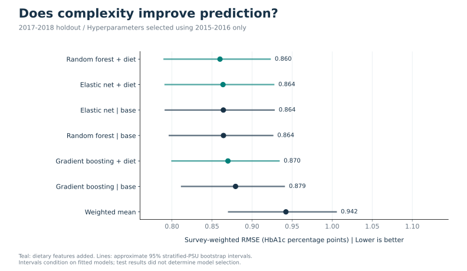
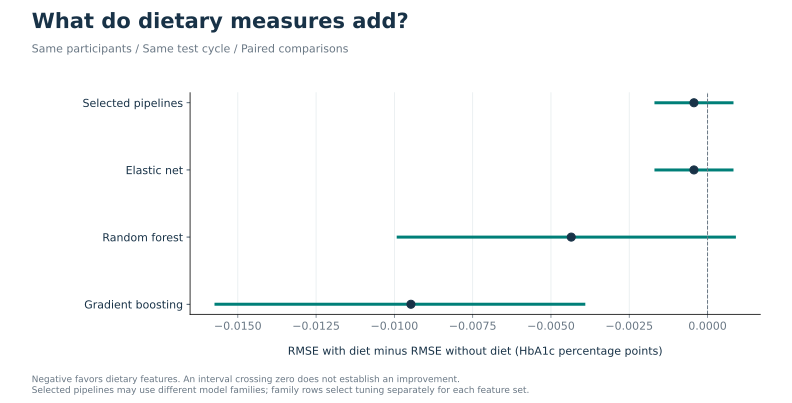
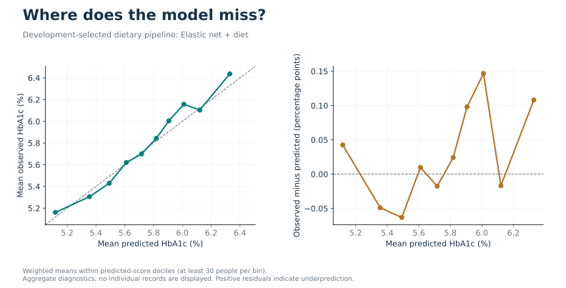
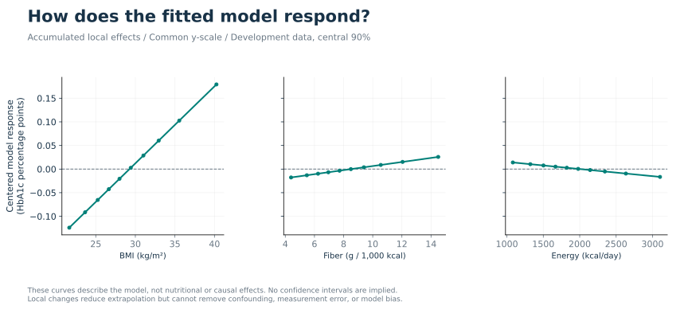

# Executed cross-cycle benchmark

## Main finding

The development-selected base pipeline is **Elastic net | base**; the dietary pipeline is **Elastic net + diet**.
On the separate 2017-2018 sample, adding diet changes weighted RMSE by **-0.0004 HbA1c percentage points**
(approximate conditional 95% interval **-0.0016 to +0.0008**). The interval includes zero: this comparison does not establish an improvement.

This is prediction of a contemporaneously measured biomarker, not prediction of future diabetes and not a test of whether changing diet changes HbA1c.

## Test performance

| model | n | rmse | rmse_lower | rmse_upper | mae | bias | r2 | unweighted_rmse |
|---|---|---|---|---|---|---|---|---|
| base:boost | 3947 | 0.879 | 0.812 | 0.940 | 0.507 | -0.009 | 0.128 | 1.035 |
| base:elastic | 3947 | 0.864 | 0.792 | 0.927 | 0.489 | -0.020 | 0.158 | 1.028 |
| base:forest | 3947 | 0.864 | 0.797 | 0.926 | 0.494 | -0.010 | 0.158 | 1.027 |
| base:mean | 3947 | 0.942 | 0.871 | 1.005 | 0.554 | -0.022 | -0.001 | 1.109 |
| diet:boost | 3947 | 0.870 | 0.800 | 0.934 | 0.500 | -0.012 | 0.147 | 1.027 |
| diet:elastic | 3947 | 0.864 | 0.792 | 0.927 | 0.490 | -0.021 | 0.159 | 1.027 |
| diet:forest | 3947 | 0.860 | 0.790 | 0.922 | 0.492 | -0.007 | 0.167 | 1.023 |

RMSE and MAE are in HbA1c percentage points. Bias is predicted minus observed. Weighted R² uses the test-sample weighted mean as its reference; it can be negative. The constant benchmark instead uses the development weighted mean.

## Dietary added value

| comparison | base_model | diet_model | rmse_difference | lower | upper |
|---|---|---|---|---|---|
| Selected pipelines | base:elastic | diet:elastic | -0.0004 | -0.0016 | 0.0008 |
| elastic | base:elastic | diet:elastic | -0.0004 | -0.0016 | 0.0008 |
| forest | base:forest | diet:forest | -0.0044 | -0.0099 | 0.0009 |
| boost | base:boost | diet:boost | -0.0095 | -0.0157 | -0.0040 |

## Error patterns

| dimension | group | n | status | rmse | mae | bias | rmse_lower | rmse_upper |
|---|---|---|---|---|---|---|---|---|
| age_group | 20-39 | 1138 | reported | 0.573 | 0.340 | 0.064 | 0.471 | 0.648 |
| age_group | 40-59 | 1274 | reported | 1.023 | 0.555 | -0.091 | 0.833 | 1.166 |
| age_group | 60+ | 1535 | reported | 0.944 | 0.594 | -0.038 | 0.842 | 1.045 |
| sex_group | Female | 2049 | reported | 0.831 | 0.449 | -0.046 | 0.667 | 0.955 |
| sex_group | Male | 1898 | reported | 0.898 | 0.535 | 0.007 | 0.820 | 0.975 |
| race_group | Mexican American | 501 | reported | 1.070 | 0.549 | -0.117 | 0.856 | 1.210 |
| race_group | Non-Hispanic Asian | 472 | reported | 0.905 | 0.485 | -0.274 | 0.760 | 1.078 |
| race_group | Non-Hispanic Black | 961 | reported | 1.018 | 0.567 | -0.168 | 0.910 | 1.117 |
| race_group | Non-Hispanic White | 1448 | reported | 0.793 | 0.468 | 0.046 | 0.646 | 0.914 |
| race_group | Other / multiracial | 202 | reported | 0.703 | 0.488 | 0.017 | 0.571 | 0.789 |
| race_group | Other Hispanic | 363 | reported | 0.963 | 0.501 | -0.083 | 0.680 | 1.179 |

Subgroup results are descriptive audits, not proof of fairness. Groups below 30 are suppressed; intervals are conditional and differences are not multiplicity-adjusted.

## Prespecified sensitivity checks

| subset | feature_set | model | n | rmse | mae | bias |
|---|---|---|---|---|---|---|
| Reports no diabetes diagnosis (DIQ010=2) | base | base:elastic | 3187 | 0.564 | 0.362 | 0.160 |
| Reports no diabetes diagnosis (DIQ010=2) | diet | diet:elastic | 3187 | 0.566 | 0.364 | 0.158 |
| Complete base predictors | base | base:elastic | 3415 | 0.862 | 0.486 | -0.011 |
| Complete base predictors | diet | diet:elastic | 3415 | 0.861 | 0.488 | -0.011 |

These are evaluation restrictions on already-fitted models, not newly trained models. Reported absence of diabetes diagnosis is not evidence of absence of diabetes. No fasting laboratory measurements or medications enter the predictors.

## Model interpretation

The dietary model was selected before test evaluation. Curves use development observations only. Correlated nutrients and noisy two-day recall summaries limit substantive interpretation.

## Cohort accounting

| cycle | step | remaining | excluded |
|---|---|---|---|
| 2015-2016 | Source demographics | 9971 | 0 |
| 2015-2016 | Age 20 or older | 5719 | 4252 |
| 2015-2016 | Not known pregnant (unknown retained) | 5649 | 70 |
| 2015-2016 | Two reliable recalls and positive WTDR2D | 4153 | 1496 |
| 2015-2016 | Measured HbA1c available (never imputed) | 3999 | 154 |
| 2015-2016 | Survey design fields available | 3999 | 0 |
| 2015-2016 | Positive two-day energy | 3999 | 0 |
| 2017-2018 | Source demographics | 9254 | 0 |
| 2017-2018 | Age 20 or older | 5569 | 3685 |
| 2017-2018 | Not known pregnant (unknown retained) | 5514 | 55 |
| 2017-2018 | Two reliable recalls and positive WTDR2D | 4095 | 1419 |
| 2017-2018 | Measured HbA1c available (never imputed) | 3947 | 148 |
| 2017-2018 | Survey design fields available | 3947 | 0 |
| 2017-2018 | Positive two-day energy | 3947 | 0 |

Missingness below is measured among adults with two reliable recalls and positive dietary weights, before outcome exclusions:

| cycle | variable | missing_n | denominator_n |
|---|---|---|---|
| 2015-2016 | LBXGH | 154 | 4153 |
| 2015-2016 | BMXBMI | 43 | 4153 |
| 2015-2016 | BMXWAIST | 165 | 4153 |
| 2015-2016 | INDFMPIR | 383 | 4153 |
| 2015-2016 | DIQ010 | 0 | 4153 |
| 2017-2018 | LBXGH | 148 | 4095 |
| 2017-2018 | BMXBMI | 37 | 4095 |
| 2017-2018 | BMXWAIST | 130 | 4095 |
| 2017-2018 | INDFMPIR | 451 | 4095 |
| 2017-2018 | DIQ010 | 0 | 4095 |

## Reproduction record

- Plan SHA-256: `3bb465c46f9555d80e80cf584a492dfe1a9914ec31fd40de62c07eda36b773eb`.
- Hyperparameters and selected pipelines: [selection.json](selection.json).
- Every candidate's development performance: [cv-results.csv](cv-results.csv).
- Development-only fold counts: [cv-folds.csv](cv-folds.csv).
- Raw data integrity: [CDC source hashes](../data/source-manifest.json).
- Runtime: `{"matplotlib": "3.11.2", "numpy": "2.5.5", "pandas": "3.1.1", "python": "3.12.14", "scikit-learn": "1.9.1", "scipy": "1.18.1"}`.
- Test rows did not enter fitting, preprocessing, hyperparameter selection, or model choice. Reproduction reruns the frozen workflow; it is not a new independent validation study.

## Limits that matter

WTDR2D accounts for dietary interview selection/nonresponse, not every missing laboratory result or covariate. This benchmark describes the eligible observed-outcome sample; it does not establish unbiased population-wide predictive performance. Two-day intake is not usual intake. The cycles are independent cross-sectional samples, not longitudinal follow-up. Known diabetes and treatment can alter both diet and HbA1c; reverse causation and residual confounding remain. The primary assay was comparable across these cycles, with a secondary-method change documented by CDC in 2017-2018.

Intervals use 1,000 stratified masked-PSU resamples and hold fitted models fixed. They are approximate, do not include development/model-selection uncertainty, and are not clinical prediction intervals. A strong average score would not establish safe performance for an individual. See [methods](../docs/methods.md) and [model card](../docs/model-card.md).
